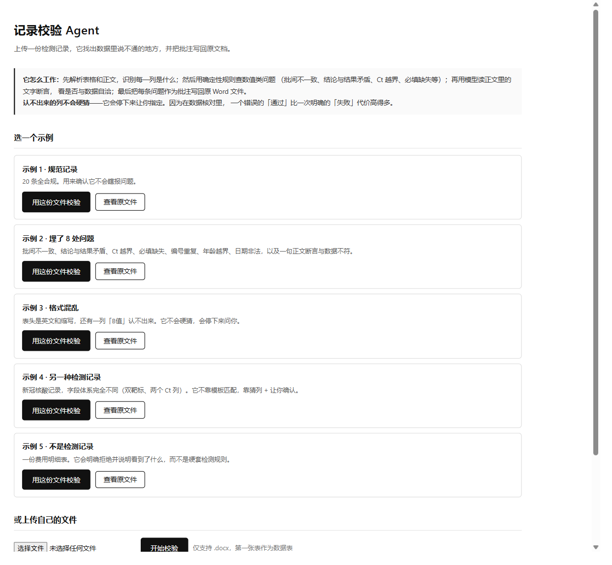
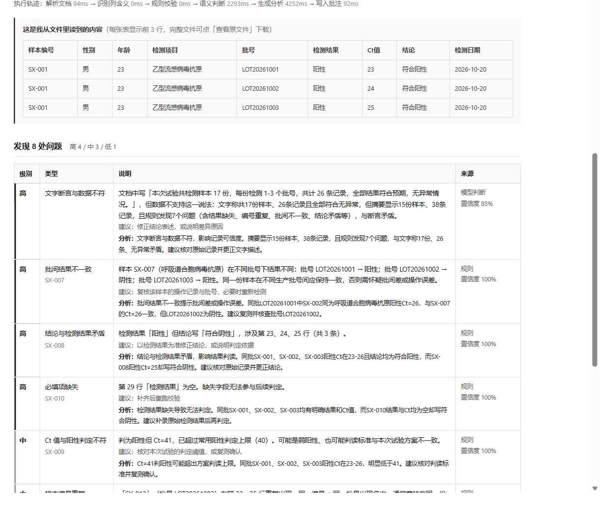
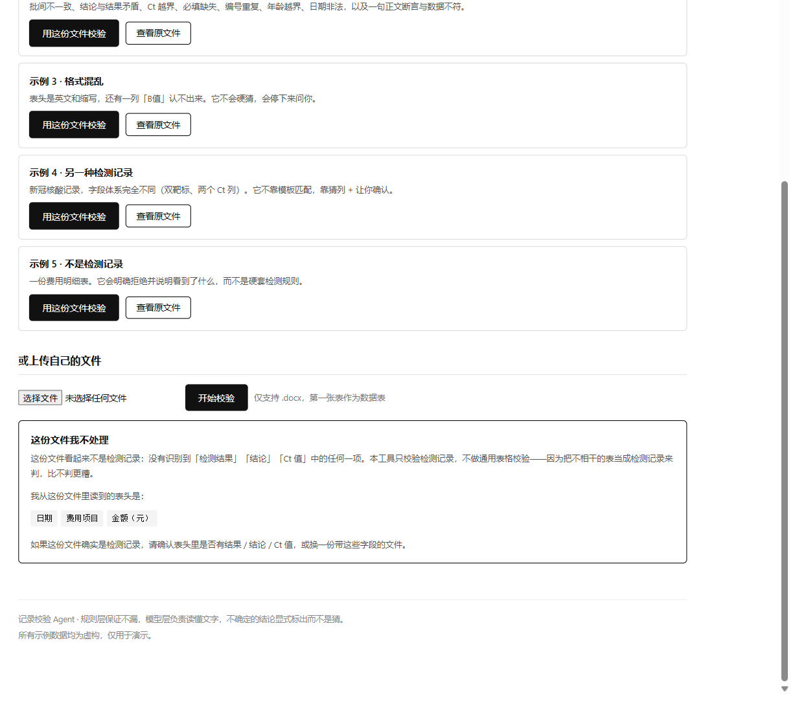

# RecordGuard · 记录核对 Agent

**一份实验记录交上来，先让机器把能算的算一遍，把算不了的部分指出来，然后在 Word 上直接打批注。**

不是聊天框。输入一份 `.docx`，输出一份**改过的 `.docx`**：可疑的单元格被框出来，旁边挂着批注说明它为什么可疑、建议怎么处理。

---

## 它长这样



*首页：5 份示例各有分工，每份都能下载原文件对照。*



*上半是"我从文件里读到了什么"——不需要相信系统，对着原文自己核一遍；下半是"发现了什么"，每条问题四段：级别、问题描述、修改建议、以及模型读完同批号其他行后写的**分析**。*



*传一份不是检测记录的文件（费用明细表）：它明确拒绝，并交代自己看到了什么。**知道什么时候不该干，比什么都能干更重要。***

---

## 为什么做这个

我做过一段时间检测记录的跨文件核对：52 份试验记录，对编盲表、对 Excel 台账、对采集表，几万个格子全靠眼睛。最后查出 5 处错误——样本编号抄错一位、该勾的项目没勾、多记了一个病原体。

这类活有三个特点：

1. **答案唯一**：一条记录的检测结果和它的结论符不符合，是客观事实，不存在"见仁见智"。
2. **错了代价极大**：一份记录对不上，整批数据可能不可用。
3. **人做这件事很差**：连续看 200 行"符合阴性"，第 201 行写错了也看不出来。

所以这件事该交给机器。但**不能整个交给大模型**——原因见下一节。

---

## 核心设计：为什么不让模型直接判断

最省事的做法是把整张表丢给大模型，问它"有没有问题"。我没这么做。

| | 规则层（确定性代码） | 模型层（大模型） |
|---|---|---|
| 算什么 | Ct 值是否越界、批号间结果是否一致、编号是否重复、日期是否存在、字段是否缺失 | 表格里的数据和正文里写的结论，是不是同一件事 |
| 为什么 | 这些有唯一答案，代码算得比模型准，且**算错了能复现、能定位、能修** | 这些没有固定写法，规则写不出来 |
| 出错时 | 改一行代码，重跑，看对不对 | 换提示词、换模型、加例子 |

**分工的理由不是"技术先进"，是"出错时我要能定位到底哪一层错了"。**

举个具体的：正文写「本次检测共 26 条记录，全部结果符合预期，无异常情况」，而表里有 3 行结论与结果矛盾。

- 规则层能算出「符合率 87%，有 3 行不符」；
- 但**它不知道这句话是在断言"全部符合"** —— 这需要读懂中文；
- 模型层的任务就是**只做这一件事**：读那句话，比对摘要，回答"这句断言和数据显示的一致吗"，并**引用原句**。

模型不碰数字运算，所以它算错数这件事不会影响结果；它只需要会读中文。

---

## 模型具体做哪三件事

不用"AI 赋能"这种词。模型在这套系统里只有三个调用点，每个都对应一件**代码做不到**的事：

| 调用点 | 给它什么 | 它返回什么 | 为什么非得用它 |
|---|---|---|---|
| **猜列含义** | 表头 + 前 4 行值 | 每列是什么字段 + 依据 + 置信度 | 列名是别人起的，穷举不完；「病历号」到底是不是样本编号，得看值的形态 |
| **核对文字断言** | 正文断言句 + 数据摘要 | 一致 / 不一致 + 理由 + 引用原句 | 要读懂「全部结果符合预期」是在断言什么，还要发现它和数据规模对不上 |
| **写问题分析** | 问题描述 + 出问题那行 + 同批其他行 | 一段业务解释 | 要做横向对比：「同批另外两支阳性 Ct 在 23-26，这条 39」 |

**第三个调用点是这套系统真正"有脑子"的地方。** 规则只能看单点——它知道 Ct=41 超了阈值，但它不知道这一批其他阳性样本的 Ct 都在 23-26，也不知道这个偏离意味着什么。

下面是真实输出（不经润色）：

> **R05 · Ct 值与阳性判定不符**
> 判定：判为阳性但 Ct=41，已超过常用阳性判定上限（40）。
> **分析：Ct=41 判阳性超出常用上限 40，可能为弱阳性或判读标准不一致。同批阳性样本 Ct 在 23-26，差异明显。建议核对试验方案判读标准并复测确认。**

这句话里的「同批阳性样本 Ct 在 23-26」不是模板，是模型现场比对出来的。

还有一处只有模型能发现：某份记录正文写「共检测 17 份样本、26 条记录，全部符合预期」，而表里实际是 **15 份样本、38 条记录**，还有 7 类问题。规则层能算出「有 7 类问题」，但**算不出"这句话声称的数字和实际记录规模对不上"**——那需要读懂这句话在声称什么。

---

---

## 一次对照实验：如果把整张表直接丢给模型会怎样

上面那段是设计理由，但"我觉得该分工"不算证据。所以我做了一次对照实验。

同一批 **17 份样本**，两种做法跑一遍：

- **纯模型**：把整张表的 markdown 直接丢给大模型，问"哪里有问题"，只要求它给出问题行号。
- **本系统的规则层**：同一批文件，8 类确定性校验。

行号级别的对比结果：

| 指标 | 纯模型（整表丢进去） | 本系统规则层 |
|---|---|---|
| 精确率 | 77.4% | **100%** |
| 召回率 | 88.9% | **100%** |
| F1 | 82.8% | **100%** |
| 单份耗时 | 约 3.1 秒 | 约 0.03 秒 |

**差距最大的不是召回率，是精确率：模型每报 4 条，有 1 条是假的。**

在这类核对里，误报的代价比漏报更隐蔽——工程师看到三条误报，就会开始**忽略所有告警**。一个会喊狼来了的检查器，最终的结局是被关掉。

还有一个差别不体现在数字上：

> 模型说「第 23 行有问题」，说不出依据。
> 规则说「第 23 行违反 R05：阳性 Ct=41，超过上限 40」。

**前者只能信，后者能核。**

（实验脚本在 `evals/baseline_llm.py`，结果存档 `evals/baseline_result.json`，可以自己复跑。）

---

## 执行链路

```
.docx  ──▶ ① 解析表格与正文
       ──▶ ② 列语义识别：规则先认，认不出的交给模型看一眼
       ──▶ ③ 规则层：8 类确定性校验
       ──▶ ④ 模型层：正文里的断言，和数据对不对得上
       ──▶ ⑤ 模型层：为每处问题写一段分析（结合同批其他行）
       ──▶ ⑥ 写回：原文件上打批注 + 汇总清单
```

**第 ② 步是这个系统最容易被低估的地方。** 真实记录的表头什么写法都有：「样本编号 / 编号 / No. / SID」，「检测结果 / 结果值 / 判定 / Result」。写死列名，换一家实验室的模板就废了。

所以它做三级识别：表头精确匹配 → 表头包含同义词 → 按列内数据特征猜（一列全是"阳性/阴性"就是结果列，全是日期就是日期列）。每一列都带置信度。

**规则认不出来的列，先让模型看，再让人定。** 模型会给一个猜测、一条依据、一个置信度，比如：

> **Ct值**（20%）
> 依据：列名是 B值，但前几行值全为空字符串，无法确认是否为 Ct 值或扩增阈值，拿不准

然后界面上摊开让人确认，**不会拿这个猜测直接往下算**。猜错一列，整份结论就废了——**多问一句的成本，远低于猜错的成本。**

---

## 8 类校验规则

| 编号 | 规则 | 严重度 | 例子 |
|---|---|---|---|
| R01 | 必填项缺失 | 高 | 结果列为空 |
| R02 | 样本编号重复 | 中 | 同一编号 + 同一批号出现两次（重复录入） |
| R03 | 批间结果不一致 | 高 | 同一份样本，批号 A 阳性、批号 B 阴性 |
| R04 | 结论与结果矛盾 | 高 | 结果写"阳性"，结论写"符合阴性" |
| R05 | Ct 值与判定不符 | 中 | 判阳性但 Ct=41（超过常用阳性上限 40） |
| R06 | 数值越界 | 中/低 | 年龄 999、Ct=99 |
| R07 | 日期格式异常 | 低 | `2026/13/45` |
| R08 | 结果值不在值域 | 低 | 结果写"待定""弱阳性" |

有一个细节值得说：**R02 最初把「同一份样本检了三个批号」误判成编号重复，一次报出 24 处误报。** 问题在于「编号重复」和「同一份样本的多次检测」在字面上分不开——必须加一个判断：**同一批号出现多次才算重复**，批号各不相同的多样本记录是正常业务结构。

这条规则改了之后，同一批样本从 24 处误报变成 0 处。

---

## 评测结果

```
样本数 : 20          命中 TP : 37
误报 FP : 0          漏报 FN : 0
准确率  : 100%       召回率  : 100%
耗时    : 493 ms（平均 24 ms/份，811 行/秒）
```

跑法：`python evals/run.py`（加 `--verbose` 看逐条明细）。

**这个 100% 必须说明它是什么：** 这 20 份样本是我按规则定义**自己埋的错**，属于白盒回归测试——它证明的是「实现和设计意图没有偏离」，**不证明**「对陌生实验室的真实记录也能 100%」。真实准确率需要人工标注的行业记录才能测，我这里没有那个数据。

我把这条写出来，是因为**一个 100% 的准确率如果不加限定，本身就是一个信号**：要么样本太简单，要么作者没想清楚这个数字意味着什么。

顺带说一个真事：这个 100% 是我**故意在盲测里把自己打了一次脸**之后才稳住的。我造了一份结构完全不同的记录去试它，结果漏了一条——日期写 `2026/02/30`，我的校验只检查了「月 1-12、日 1-31」，2 月 30 日就这么过去了。改成真实日历校验之后才抓到。**规则写得再细，也会有想不到的洞；所以模型那一层不能省，人工那一层更不能省。**

---

## 你可以这样刁难它

上面的数据你可以不信。打开 `samples/sample_errors.docx`，改几处试试——下面每一种改法，系统都有确定的行为：

| 你怎么改 | 它会怎么反应 | 为什么 |
|---|---|---|
| 把 SX-007 三个批号改成一样 | **不再报**「批间不一致」 | 问题消失了就该闭嘴，而不是继续喊 |
| 把某行日期改成 `2026/02/30` | 报「日期格式异常」 | 2 月没有 30 日——这里用的是真实日历校验，不是 `1<=月<=12` |
| 把表头改成英文缩写（`Lot No.` / `Ct`） | **停下来问**你这几列是什么 | 认不出就问，不猜 |
| 把整张表换成一份费用明细 | **明确拒绝**，并列出它看到的表头 | 不是检测记录，就不硬套检测规则 |

**共同点：它从不假装自己什么都能干。**

如果你改出一个它没有预期反应的情况，那就是我没覆盖到的——这一条不是客套，是这份东西还有多少没做完的真实边界。

## 已知局限

1. **只处理 docx 里的表格。** 扫描件、图片、PDF 需要先有文本层，这一版不做 OCR——OCR 会引入新的错误源，让"错了到底是谁的错"变得无法归因。
2. **合并单元格、跨页表格可能解析失败。** 遇到就明确报错，不硬解析出一堆错位的数据。
3. **规则阈值是按常见试剂说明书设的默认值**（Ct 阳性上限 40、阴性下限 35），不同产品判定标准不同，需要按方案调整。
4. **语义层只检查"含断言词的句子"**，不检查通篇叙述逻辑。判断不了"这段讨论写得好不好"。
5. **没做过压力测试。** 200 行的表跑得动，5 万行的表没试过。
6. **配了模型之后单次校验要 3-5 秒**（其中模型两次调用约 4 秒），不是瞬时。真实的复核场景里这个延迟无所谓，但如果要做批量流水线，需要改成异步队列。

---

## 如果继续做，下一步

- **接入真实标注数据做真正的评测**：现在只有白盒样本，需要一批人工标注过的真实记录，才能说出"漏检率 3%"这样的话。
- **规则可配置化**：把阈值和字段同义词表抽成配置文件，让不同产品线自己维护，而不是改代码。
- **批注分级回写**：现在所有批注一个样式，可以按严重度分色，让人一眼看出哪几条必须处理。
- **和填报流程打通**：核对完之后直接生成"修改后版本"，而不是只给批注让人手改。

---

## 怎么跑

**Windows：双击 `start.bat`**，浏览器会自动提示打开 `http://127.0.0.1:8000`。关掉黑窗口就停了。

手动跑：

```bash
pip install -r requirements.txt

# 网页版（推荐，能直接看到效果）
python app.py
# 打开 http://127.0.0.1:8000

# 命令行版
python cli.py samples/sample_errors.docx
# 输出 samples/sample_errors_已批注.docx

# 评测
python evals/run.py
```

**网页里有三份预置样例，点一下就出结果：**

| 样例 | 用途 | 预期 |
|---|---|---|
| 示例一·规范数据 | 证明它不瞎报 | 0 处问题 |
| 示例二·含问题数据 | 主演示 | 8 处问题（含 1 处需要读文字才能发现） |
| 示例三·格式不规范 | 证明它知道自己不行 | 停下来让你指定列含义 |

配了 API key 就走模型（猜列 / 核对文字 / 写分析三个调用点都启用），没配则语义判断走本地启发式兜底，并且**在结果里明确标出来源是 `heuristic` 还是 `model`**——不冒充。

配了 key 之后，执行轨迹会从 4 步变成 6 步，多出「猜测列含义」和「生成分析」两行，一眼能看出模型在哪、花了多少毫秒：

```
解析文档 34ms → 识别列含义 0ms → 规则校验 0ms →
语义判断 1410ms → 生成分析 3281ms → 写入批注 20ms
```

```bash
# .env（不进版本库）
RG_API_KEY=sk-xxxx
RG_BASE_URL=https://api.deepseek.com
RG_MODEL=deepseek-chat
```

---

## 目录

```
rg/
  docx_io.py    读写 docx、写批注
  layout.py     列语义识别（三级 + 置信度）
  rules.py      8 类确定性规则
  judge.py      模型层：猜列 / 断言核对 / 问题分析（含启发式兜底）
  pipeline.py   编排 + 执行轨迹
app.py          网页界面（零依赖，标准库 http.server）
cli.py          命令行入口
evals/          评测集与评测脚本
samples/        三份示例 + 15 份评测变体
```
